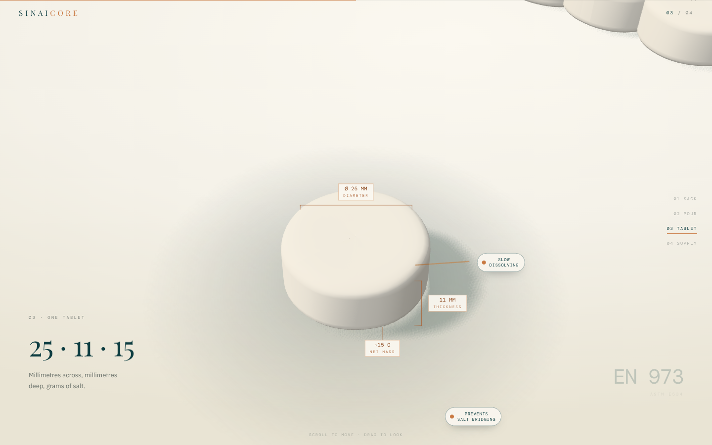
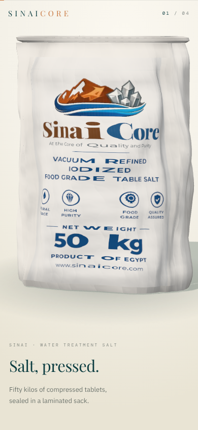

# SinaiCore — صفحة القصة

الصفحة الرسمية للمستودع هي **قصة المنتج**: مرحلة ثلاثية الأبعاد واحدة، والمجسّم
هو البطل — اسكرول، يتحرك المشهد، وتظهر الأرقام والكلمات على إيقاع حركته.

- الشيكارة تدور وتنفتح وتتقلب فيُسقط **64 قرصًا**، والعدّاد بيعدّ اللي نزل فعلًا.
- الكاميرا تدخل على قرص واحد، فتظهر أبعاده (`Ø 25 mm` / `11 mm` / `~15 g`) حوله.
- الكوبي كله سطر أو اتنين لكل فصل + رقم واحد. مفيش جداول ولا فقرات.
- **شريط منتجات** فوق: خمس منتجات في نفس المشهد — الشيكارة (50 كجم أو جامبو 1 طن)
  ولون الطبع والحبيبات المتساقطة (أقراص / حبيبات ناعمة / بلورات) والأرقام كلها بتتبدّل.
- **قسم التشكيلة** (`#range`): خمس شاشات، منتج واحد في كل شاشة — شيكارة كبيرة،
  اسم بالحجم الكبير، نقاء، مقاس، وسطر واحد، وثلاث استخدامات. الشيكارة تتغيّر مع
  التمرير، والنص يمين وشمال بالتبادل.
- **قسم الملاحة** في آخر الصفحة: ثمانية فصول تحريرية بصور حقيقية من غير أي 3D —
  مجلة، مش مشهد.
- زرار **AR / EN** فوق بيحوّل الصفحة كلها للعربية (`dir="rtl"`) — الزوايا والكاميرا
  مش بيتغيّروا، النص بس بيتقلب جهته، والاختيار بيتحفظ للزيارة الجاية.

[](viewer/story/)

**اللينك الحيّ:** <https://ahmedlasheenrespicare-png.github.io/sinaicore/>
· **بديل مباشر من المستودع:** <https://cdn.statically.io/gh/ahmedlasheenrespicare-png/sinaicore/main/story-build/index.html>

<p>



</p>

---

## تشغيل صفحة القصة

```bash
npm ci
npm run story          # http://localhost:5175
```

سيرفر Vite مستقل جذره `viewer/story` — منفصل عن التطبيق (5173) وعن الورقة
التفاعلية (5174) عشان تعديل القصة ما يلمسش حاجة تانية. الأصول بتتقرأ من
`public/` الرئيسي (`models/`, `textures/`, `artwork/`, `draco/`).

## إزاي تعدّل القصة

**القاعدة الأولى:** كل نص أو رقم لازم يكون مربوط بحالة المجسّم، مش بتوقيت مستقل.
`syncHud()` في `main.js` بيقرأ `smoothProgress` وحالة الصبّ كل frame ويشغّل/يقفل
طبقات `.ov` (ونسبة ظهورها = قرب المجسّم من الحالة دي).

| الملف | الدور |
| --- | --- |
| `viewer/story/index.html` | كل الفصول والكوبي والـCSS (الزجاج، العناوين، شريط التقدّم، نقاط التنقّل) داخل ملف واحد |
| `viewer/story/main.js` | المشهد: الكاميرا، الشيكارة، الصبّ، علامات القياس، الـhotspots، والـtimeline اللي بيحوّل التمرير لقيم |
| `viewer/story/products.js` | بيانات الخمس منتجات: النصوص، الأرقام، حجم الشيكارة، وشكل الحبيبات. أي رقم في الصفحة بيتغيّر من هنا |
| `public/artwork/still-*.webp` | صورة كل شيكارة في قسم التشكيلة، مصوّرة من نفس مشهد الـ3D (خلفية شفافة) |
| `viewer/story/chapters.js` | فصول الملاحة التحريرية (عنوان، مقدمة، نص، رقمين، صورة، تعليق) عربي + إنجليزي |
| `viewer/story/vite.config.ts` | بورت 5175، ومصدر الأصول، و`base` وقت النشر |

- **الكوبي** مكتوب في `index.html` جوّه `.panel-inner` — الفصول بالسطر
  `<section class="panel" id="panel-N">`، وكل فصل ليه `.sticky` بارتفاع `100svh`
  جوّه قسم طويل (الارتفاع الكلي في CSS لكل فصل).
- **الحركة** كلها في `buildStory()` داخل `main.js`: تويينات GSAP على قيم الحالة
  (`state.bag`, `state.pour.u`, `state.cam.k`, `state.annot.v`)، والـtimeline
  لازم ينتهي عند `1` بالظبط.
- **الأبعاد والـhotspots** مرسومة في مساحة الشاشة من `buildAnnotations()` و
  `updateDims()`، فالخطوط بتفضل حادّة في أي زوم.
- **منتج جديد**: زوّد عنصر في `products.js` و`id` في `PRODUCT_ORDER` — المشهد بيعيد بناء
  الحبيبات والـtimeline لوحده، والصورة المطبوعة للشيكارة بتتولد بـ`npm run artwork`
  (القالب واحد في `artwork/sack-50kg-front.html` بياخد `?product=` و`?weight=`).
- **صور التشكيلة**: لو غيّرت طبع الشيكارة، أعِد تصويرها من المشهد نفسه (سكربت
  سكرين شوت بيختار المنتج ويخفي كل حاجة ما عدا `sack-body` و`sack-panel`،
  وبعدين `convert -crop` على حدود الشيكارة +26px ← `still-<id>.webp`).
- **التعريب**: كل عنصر نص إنجليزي جنبه `data-ar` بنفس النص بالعربي. `setLanguage()`
  بيبدّل النص و`dir` وبيكتب `lang-toggle`، و**بيمنع تقسيم الحروف** في العناوين العربية
  (الحرف العربي موصول، لو اتقسّم لكروت منفصلة بيتقطع).
- **المعاينة السريعة** لأي حالة: `window.__viewer.lock(0.5)` في الـconsole.

## النشر

`.github/workflows/pages.yml` بيبني الصفحة بـ`PAGES_BASE=/sinaicore/` وينشرها
على GitHub Pages مع كل push لـ`main`.

> **مطلوب مرة واحدة:** `Settings → Pages → Source: GitHub Actions`.
> لحد ما ده يتظبط، فيه نسخة مبنية بمسارات نسبية في `story-build/` بتفتح من أي
> CDN مباشرة.

```bash
npm run story:build                     # dist-story/ للمسار /sinaicore/
PAGES_BASE=./ npm run story:build       # تخريج بمسارات نسبية لـ story-build/
```

## باقي المستودع

| الأمر | إيه ده | البورت |
| --- | --- | --- |
| `npm run dev` | تطبيق React للسرد الطويل (ثمانية فصول) | 5173 |
| `npm run viewer` | ورقة بيانات المنتج التفاعلية (صفحة خاصة) | 5174 |
| `npm run assets` | بلورة GLB/Draco وخرائط KTX2 |

الأصول: `public/models/sack.glb` (شيكارة 50 كجم)، `public/models/tablet.glb`
(قرص مضغوط)، `public/artwork/sack-50kg-texture.png` (الطبعة)، والخرائط في
`public/textures/`. السكربتات في `scripts/`.

المواصفات المستخدمة في القصة: NaCl ≥ 99.50 %، رطوبة ≤ 0.20 %، مواد غير ذائبة
≤ 0.03 %، قطر 25 مم، سُمك 11 مم، ‎≈15 جم للقرص، طريقة EN 973 / ASTM E534.
