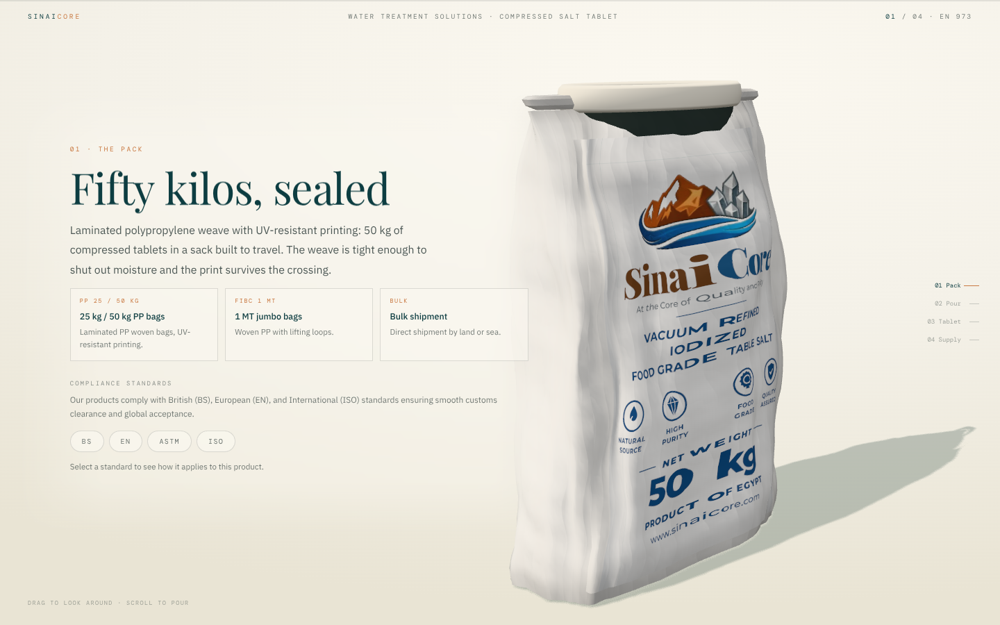
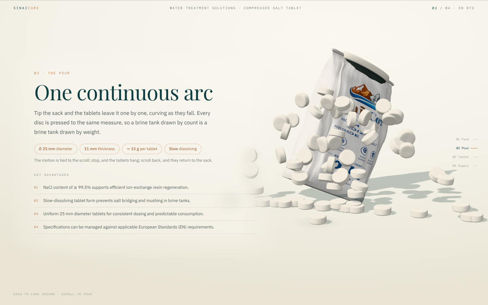

# SinaiCore — صفحة القصة

الصفحة الرسمية للمستودع هي **قصة المنتج**: مرحلة واحدة ثابتة ثلاثية الأبعاد،
وتمرير يفتح سبعة فصول — الشيكارة، الصبّ، القرص، المواصفات، ليه بيشتغل، فين
بيُستخدم، والتوريد.

[](viewer/story/)

**اللينك الحيّ:** <https://ahmedlasheenrespicare-png.github.io/sinaicore/>
· **بديل مباشر من المستودع:** <https://cdn.statically.io/gh/ahmedlasheenrespicare-png/sinaicore/main/story-build/index.html>

<p>


</p>

---

## تشغيل صفحة القصة

```bash
npm ci
npm run story          # http://localhost:5175
```

سيرفر Vite مستقل جذره `viewer/story` — منفصل عن التطبيق (5173) وعن الورقة
التفاعلية (5174) عشان تعديل القصة ما يلمسش حاجة تانية. الأصول بتتقرأ من
`public/` الرئيسي (`models/`, `textures/`, `artwork/`, `draco/`).

## إزاي تعدّل القصة

| الملف | الدور |
| --- | --- |
| `viewer/story/index.html` | كل الفصول والكوبي والـCSS (الزجاج، العناوين، شريط التقدّم، نقاط التنقّل) داخل ملف واحد |
| `viewer/story/main.js` | المشهد: الكاميرا، الشيكارة، الصبّ، علامات القياس، الـhotspots، والـtimeline اللي بيحوّل التمرير لقيم |
| `viewer/story/vite.config.ts` | بورت 5175، ومصدر الأصول، و`base` وقت النشر |

- **الكوبي** مكتوب في `index.html` جوّه `.panel-inner` — الفصول بالسطر
  `<section class="panel" id="panel-N">`، وكل فصل ليه `.sticky` بارتفاع `100svh`
  جوّه قسم طويل (الارتفاع الكلي في CSS لكل فصل).
- **الحركة** كلها في `buildStory()` داخل `main.js`: تويينات GSAP على قيم الحالة
  (`state.bag`, `state.pour.u`, `state.cam.k`, `state.annot.v`)، والـtimeline
  لازم ينتهي عند `1` بالظبط.
- **الأبعاد والـhotspots** مرسومة في مساحة الشاشة من `buildAnnotations()` و
  `updateDims()`، فالخطوط بتفضل حادّة في أي زوم.
- **المعاينة السريعة** لأي حالة: `window.__viewer.lock(0.5)` في الـconsole.

## النشر

`.github/workflows/pages.yml` بيبني الصفحة بـ`PAGES_BASE=/sinaicore/` وينشرها
على GitHub Pages مع كل push لـ`main`.

> **مطلوب مرة واحدة:** `Settings → Pages → Source: GitHub Actions`.
> لحد ما ده يتظبط، فيه نسخة مبنية بمسارات نسبية في `story-build/` بتفتح من أي
> CDN مباشرة.

```bash
npm run story:build                     # dist-story/ للمسار /sinaicore/
PAGES_BASE=./ npm run story:build       # تخريج بمسارات نسبية لـ story-build/
```

## باقي المستودع

| الأمر | إيه ده | البورت |
| --- | --- | --- |
| `npm run dev` | تطبيق React للسرد الطويل (ثمانية فصول) | 5173 |
| `npm run viewer` | ورقة بيانات المنتج التفاعلية (صفحة خاصة) | 5174 |
| `npm run assets` | بلورة GLB/Draco وخرائط KTX2 |

الأصول: `public/models/sack.glb` (شيكارة 50 كجم)، `public/models/tablet.glb`
(قرص مضغوط)، `public/artwork/sack-50kg-texture.png` (الطبعة)، والخرائط في
`public/textures/`. السكربتات في `scripts/`.

المواصفات المستخدمة في القصة: NaCl ≥ 99.50 %، رطوبة ≤ 0.20 %، مواد غير ذائبة
≤ 0.03 %، قطر 25 مم، سُمك 11 مم، ‎≈15 جم للقرص، طريقة EN 973 / ASTM E534.
